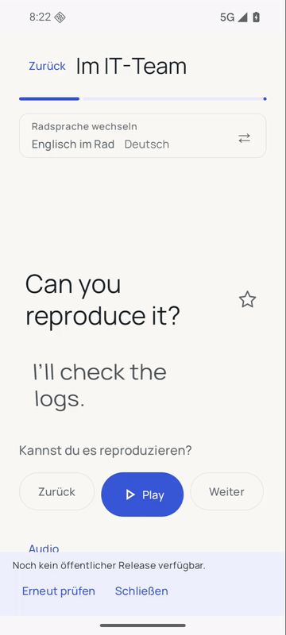
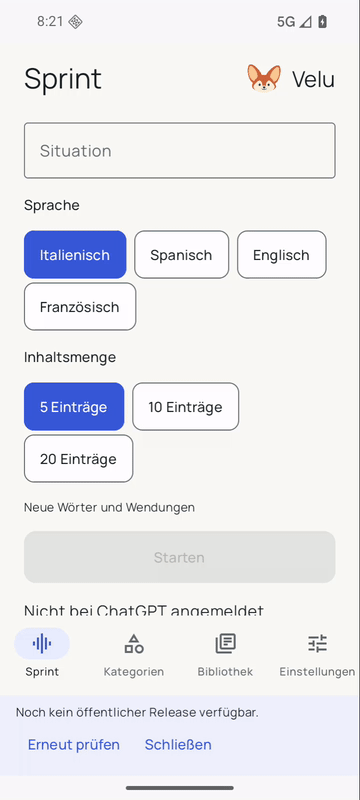

<p align="center"></p>
<h1 align="center">Velu</h1>
<p align="center"><strong>Wörter und Sätze für deine Situation. Hören, verstehen, wiederfinden.</strong></p>
<p align="center">Native Android-App · Kotlin & Jetpack Compose · Android-System-TTS</p>

<p align="center">
  <a href="https://github.com/babafish12/velu/releases/latest">Releases / APK</a> ·
  <a href="#vorschau">Vorschau</a> ·
  <a href="docs/BUILDING.md">Selbst bauen</a> ·
  <a href="#daten-und-verbindungen">Daten und Verbindungen</a>
</p>

## Was ist Velu?

Velu verbindet situationsbezogene Sprachlektionen mit einem einfachen Audio-Player. Du wählst eine Situation, die Lernsprache und die gewünschte Inhaltsmenge. Gespeicherte Lektionen und mitgelieferte Beispiele sind ohne Anmeldung nutzbar.

- **Inhalt statt Stoppuhr:** 5, 10 oder 20 Wörter-/Satz-Einträge; die Wiedergabe füllt keinen künstlichen Minutentimer. Ergänzende Dialogzeilen und Verständnisfragen zählen nicht als zusätzliche Einträge.
- **Direktes Eintragsrad:** Durch Einträge drehen, eine Stelle auswählen und zwischen Lernsprache und deutscher Übersetzung als Haupttext wechseln.
- **Deine Bibliothek:** Ganze Lektionen oder einzelne Einträge abspielen; schwierige Einträge mit einem Stern markieren.
- **Ruhe außerhalb der App:** Beim Verlassen stoppt die Wiedergabe. Es bleiben keine Medien-Play-Buttons in der Benachrichtigung. Beim Zurückkehren startest du selbst wieder.
- **Systemstimmen statt Cloud-TTS:** Android-System-TTS übernimmt die Sprachausgabe. Offline-Wiedergabe benötigt vorhandene Audiodateien oder passende installierte Offline-Stimmen zum lokalen Erzeugen der Audiodaten.
- **Updates mit Zustimmung:** Velu prüft öffentliche GitHub-Releases. APKs werden erst nach Zustimmung geladen und vor dem Android-Installationsdialog geprüft.

Lernsprachen: Italienisch, Spanisch, Englisch und Französisch; Übersetzungen auf Deutsch. Die Oberfläche ist nativ, keine eingebettete Website.

## Vorschau

Echte Bildschirmaufnahmen aus der getesteten Android-App mit mitgelieferten Beispielen – keine nachgebauten Oberflächen. Die Aufnahmen entstanden vor der Erstveröffentlichung; der damalige Hinweis zum noch fehlenden öffentlichen Release bleibt sichtbar. Die stummen GIFs sind keine Livekonto-, Hör- oder Installationsnachweise.

### Eintragsrad und Sprachwechsel


### Inhaltsmenge und Bibliothek


## Installieren

Voraussetzung: Android 9 / API 28 oder neuer. APK für diesen Stand: **`velu-0.3.0.apk`**, Paket `de.voci`, Versionscode `3`.

1. Die APK aus den [Releases](https://github.com/babafish12/velu/releases/latest) herunterladen.
2. Auf Android öffnen und die Installation im Systemdialog bestätigen. Android kann eine Freigabe für die installierende App verlangen.
3. Für Offline-Sprachausgabe die passenden Offline-Stimmen in den Android-TTS-Einstellungen installieren.

Der APK-gebundene Prüfstand steht in [TESTING.md](docs/TESTING.md) und [verification.json](docs/verification.json). Die native Installerprüfung bestätigt eine vollständige Neuinstallation derselben Version mit Datenerhalt; sie ist kein Nachweis einer höher-versionierten Live-GitHub-Updatekette.

**Bereits VOCI, Spreli oder Velu installiert?** Die Paketkennung bleibt `de.voci`. Ein Update ohne Datenverlust setzt unter anderem einen passenden Signierschlüssel und eine höhere `versionCode` voraus. Kompatibilität nicht allein aus dem App-Namen ableiten. Nicht vorsorglich deinstallieren: Dabei können lokale Lektionen und Einstellungen verloren gehen.

**Früher Entwicklungsstand:** Der bisherige APK-Pfad verwendet eine Debug-/Entwicklungssignatur, keine hier zugesicherte Produktionssignatur. Selbst gebaute APKs und CI-APKs verwenden andere lokal erzeugte Debug-Schlüssel und sind nicht automatisch mit einer verteilten APK updatekompatibel. Signierschlüssel werden nicht veröffentlicht. Details: [BUILDING.md](docs/BUILDING.md) und [RELEASING.md](docs/RELEASING.md).

## Neue Lektionen erzeugen

Neue Lektionen benötigen Internet, eine eigene unterstützte ChatGPT-Anmeldung und die erforderliche Freigabe des Kontos. Es gibt keinen separat einzutragenden OpenAI-API-Key und keinen zusätzlichen Cloud-TTS-Anbieter. Das ist **keine Zusage**, dass jedes ChatGPT-Konto oder jeder Tarif die Generierung unterstützt, und keine Garantie kostenfreier oder unbegrenzter Nutzung. Die Anmeldung eines Entwicklungswerkzeugs wird nicht in die App übernommen.

Die ChatGPT-Anbindung ist experimentell: Kontoberechtigungen, Anmeldeverfahren, Modelle und Limits hängen vom Anbieter ab. Synthetische Tests belegen keine persönliche Live-Anmeldung oder reale Generierung. Gespeicherte Inhalte und Beispiele bleiben getrennt davon ohne Login nutzbar. Eine Antwort mit unpassender Eintragszahl wird nicht stillschweigend mit Wiederholungen aufgefüllt.

## Daten und Verbindungen

- Lektionen, Einstellungen und vorbereitete Audiodateien werden lokal in der App gespeichert. Automatisches Android-Backup ist im Manifest deaktiviert; eine Neuinstallation ist kein Sicherungsverfahren.
- Bei der Erstellung neuer Lektionen gehen die erforderlichen Anfragen an den unterstützten Anbieter. Keine vertraulichen Inhalte als Lernauftrag eingeben, wenn du sie nicht an diesen Dienst senden möchtest.
- Für Updateabfragen ist kein GitHub-Login nötig; Lerninhalte sind dafür nicht erforderlich. GitHub erhält übliche Verbindungsdaten, etwa die IP-Adresse.
- Offline-Stimmen werden von der installierten Android-TTS-Engine bereitgestellt. Verfügbarkeit und vorheriger Download hängen von Engine, Gerät und Sprache ab.
- Keine Tokens, Passwörter, persönlichen Lektionen oder ungefilterten Geräteprotokolle in Issues veröffentlichen; siehe [SECURITY.md](SECURITY.md).

## Updates

Die App prüft Downloadlänge, SHA-256, tatsächliche Paketkennung, höhere Android-Versionsnummer und den zur installierten App passenden Signierer. „Später“ startet keinen APK-Download. Android entscheidet über die Installation: keine stille Installation, kein Root, kein Umgehen der Systemabfragen. Fehlende Releases oder Netzwerkfehler sind kein Grund, vorhandene Lektionen zu sperren.

Der technische Vertrag und die Veröffentlichungscheckliste stehen in [RELEASING.md](docs/RELEASING.md).

## Selbst bauen

Benötigt werden JDK 21, Android-SDK-Plattform `android-37.2` und Build Tools `36.0.0`. Der Gradle-Wrapper enthält die festgelegte Gradle-Version samt Prüfsumme. Nach Einrichtung aus dem Repositoryroot:

```sh
./gradlew --no-daemon --console=plain :app:testDebugUnitTest :app:lintDebug :app:assembleDebug
```

Ausgabe: `app/build/outputs/apk/debug/app-debug.apk`. Vollständige Einrichtung und Signaturgrenzen: [BUILDING.md](docs/BUILDING.md).

## Aufbau und Prüfstand

- `app/src/main/java/de/voci/` – UI, Bibliothek, Audio, Authentifizierung und Updates.
- `app/src/test/` – JVM-Tests; `app/src/androidTest/` – Android-/Compose-Tests.
- `app/src/main/assets/licenses/` – offline lesbares Drittanbieterpaket einschließlich vollständiger Lizenztexte.
- [TESTING.md](docs/TESTING.md) – **143 JVM-Tests und 110 Android-Testfälle bestanden**, Lint: **0 Fehler / 16 Warnungen**. Echte UI-Navigation und native Installation mit anschließendem Neustart und Datenerhalt geprüft. Genaue Methoden, APK-Hash und Grenzen: [verification.json](docs/verification.json).

Die [CI-Konfiguration](.github/workflows/android.yml) beschreibt JVM-Tests, Lint und Debug-Build; ihre Existenz ist kein erfolgreicher CI-Lauf. Emulatorprüfungen belegen weder physisches Hören noch Bluetooth-Verhalten oder vollständige TalkBack-Bedienbarkeit.

## Lizenzen und Gestaltung

Eigene Quellen stehen unter [MIT](LICENSE). Bibliotheken, Schriften und andere Drittanbieterbestandteile behalten ihre jeweiligen Bedingungen. Das vollständige lokale Paket bleibt an seinem Originalort: [Drittanbieterhinweise](app/src/main/assets/licenses/THIRD_PARTY_NOTICES.md) und [Lizenzindex](app/src/main/assets/licenses/index.json). Die darin enthaltenen `texts/`-Links sind relativ zu diesem Verzeichnis; keine isolierte Rootkopie verwenden.

Herkunft und Abgrenzung der Grafiken: [ASSETS.md](docs/ASSETS.md). Das Velu-Fennek-Motiv wurde mit KI-Unterstützung erzeugt und angepasst; daraus folgt keine Zusicherung exklusiver Rechte. Velu ist kein offizielles Produkt von OpenAI oder Google.
